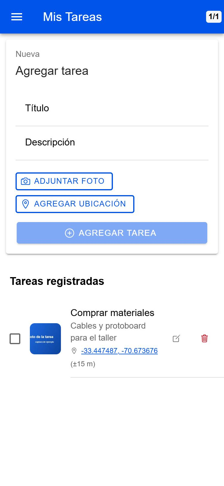
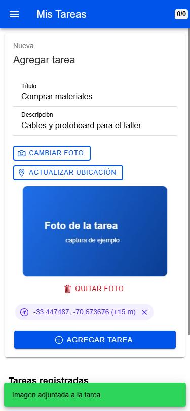
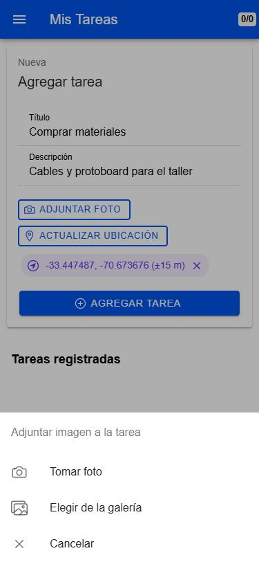
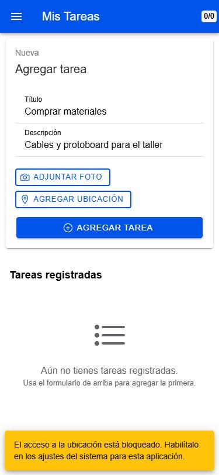
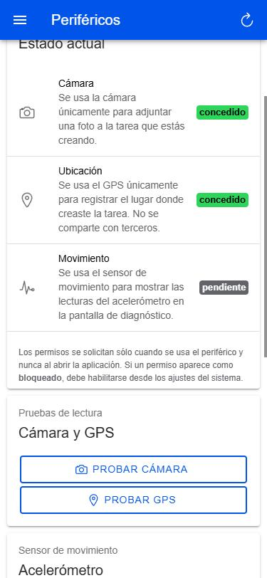
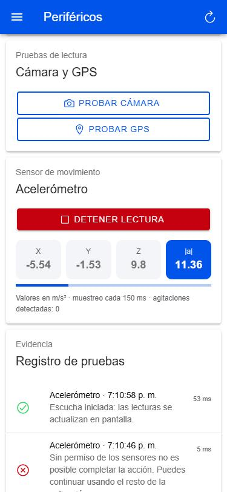
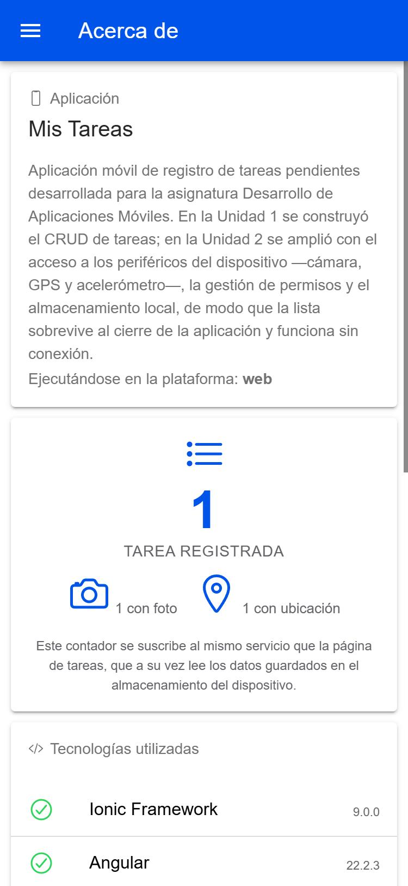

# Mis Tareas — Aplicación móvil con Ionic

### Informe de la Evaluación Sumativa · Unidad 2

| | |
|---|---|
| **Asignatura** | Desarrollo de Aplicaciones Móviles |
| **Institución** | Instituto Profesional San Sebastián |
| **Profesor** | Boris Marcelo Belmar Muñoz |
| **Integrantes** | Diego Abaroa · Claudio Ramos |
| **Proyecto** | `todo-ionic` — continuación del proyecto de la Unidad 1 |
| **Entrega** | Noviembre de 2026 |

---

## 1. Resumen

Aplicación móvil de lista de tareas (**To-Do List**) construida con **Ionic + Angular + Capacitor**.

En la **Unidad 1** se desarrolló el CRUD de tareas (título y descripción), la navegación con menú
lateral y la página "Acerca de".

En la **Unidad 2** —este entregable— la misma aplicación se amplió para **interactuar con los
periféricos del dispositivo a través de sus APIs internas**:

- 📷 **Cámara / galería**: adjuntar una fotografía a cada tarea.
- 📍 **GPS**: registrar la ubicación donde se creó la tarea, con su precisión.
- 📈 **Acelerómetro**: lectura continua del sensor de movimiento, con detección de agitación.
- 💾 **Almacenamiento local**: las tareas (con su foto y su ubicación) persisten en el dispositivo
  y la aplicación funciona **sin conexión a internet**.
- 🔐 **Permisos de usuario**: solicitud *just-in-time*, justificada y con manejo del rechazo.
- 🧪 **Pruebas**: 87 pruebas automatizadas y una pantalla de diagnóstico para probar los
  periféricos sobre el dispositivo real.

> **Alcance de la entrega.** Según lo indicado por el profesor, en esta evaluación **sólo se evalúa
> la conexión con las APIs internas del dispositivo**, no la integración con servicios web o APIs
> externas. Por ese motivo la sincronización remota de tareas no forma parte del desarrollo: todo
> el almacenamiento es local al dispositivo. El proyecto es el mismo de la Unidad 1 y conserva el
> mismo repositorio; este `README.md` es el informe de la evaluación.

---

## 2. Capturas de pantalla

### 2.1 Tarea con foto y ubicación

La tarea guardada muestra la miniatura de la foto, las coordenadas (enlazadas a un mapa) y la
precisión del GPS. La captura está tomada **después de recargar la aplicación**: la lista se
recuperó desde el almacenamiento del dispositivo.



### 2.2 Formulario con los datos capturados por los periféricos



### 2.3 Elección del origen de la imagen

Antes de abrir la cámara se consulta al usuario si desea tomar una foto o elegir una existente.



### 2.4 Manejo de un permiso rechazado

Cuando el permiso está bloqueado la aplicación **no se cae ni se queda cargando**: informa el
motivo y explica cómo recuperarlo, y el resto de la aplicación sigue utilizable.



### 2.5 Pantalla "Periféricos": estado de los permisos

Cada permiso se muestra con su estado actual y con el motivo por el cual la aplicación lo necesita.
Esta consulta **no abre ningún diálogo del sistema**.



### 2.6 Acelerómetro en vivo y registro de pruebas

Lecturas X / Y / Z, módulo del vector de aceleración y registro de cada prueba ejecutada con su
resultado y su **tiempo de respuesta en milisegundos**.



### 2.7 Página "Acerca de"



> Las capturas se tomaron con la aplicación servida en `http://localhost:8100` y el navegador
> emulando un dispositivo de 375 × 812 px. En el navegador de escritorio no hay GPS ni
> acelerómetro reales, por lo que esas lecturas se simularon reemplazando la API del navegador
> (la misma técnica que usan las pruebas automatizadas). El comportamiento sobre hardware real se
> verifica con la pantalla **Periféricos** descrita en la sección 7.2.

---

## 3. Arquitectura de la solución

```
src/app/
├── models/
│   ├── periferico.model.ts     Tipos comunes a todos los periféricos
│   └── tarea.model.ts          Tarea (+ foto y ubicación)
├── services/
│   ├── permisos.service.ts     Fachada única de permisos
│   ├── camara.service.ts       @capacitor/camera + @capacitor/filesystem
│   ├── ubicacion.service.ts    @capacitor/geolocation
│   ├── sensor.service.ts       @capacitor/motion
│   ├── almacenamiento.service.ts  @capacitor/preferences (repositorio)
│   └── tarea.service.ts        Estado y CRUD de la lista
├── home/                       Lista de tareas + formulario
├── perifericos/                Pantalla de diagnóstico de periféricos
└── acerca/                     Información del proyecto
```

### Patrones de diseño aplicados

| Patrón | Dónde | Para qué |
|---|---|---|
| **Adapter** | `CamaraService`, `UbicacionService`, `SensorService` | Cada plugin de Capacitor queda encapsulado tras una interfaz propia (`FotoTarea`, `UbicacionTarea`, `LecturaSensor`). Las páginas no dependen del SDK y las pruebas pueden sustituir el plugin. |
| **Facade** | `PermisosService` | Un único punto que aplica siempre las mismas reglas de permisos, en lugar de repetir `requestPermissions()` por toda la aplicación. |
| **Repository** | `AlmacenamientoService` | El resto de la aplicación no sabe dónde se guardan las tareas; se podría cambiar el motor de persistencia sin tocar las páginas. |
| **Observer** | `TareaService.tareas$`, `SensorService.lectura$` | El estado se publica en observables de RxJS; las páginas suscritas se actualizan solas. |
| **Result Object** | `ResultadoPeriferico<T>` | Ningún servicio de periférico lanza excepciones hacia la vista: devuelve `{ ok: true, datos }` o `{ ok: false, motivo, mensaje }`, de modo que la interfaz siempre puede mostrar un mensaje adecuado. |
| **Inyección de dependencias** | Todos los servicios (`inject()`) | Permite reemplazar cualquier servicio por un doble de prueba en los tests. |

### El tipo `ResultadoPeriferico`

Es la pieza central del manejo de errores. Cada operación sobre un periférico devuelve:

```ts
type ResultadoPeriferico<T> =
  | { ok: true;  datos: T; duracionMs: number }
  | { ok: false; motivo: MotivoFallo; mensaje: string; duracionMs: number };

type MotivoFallo =
  | 'permiso-denegado'   // el usuario rechazó la solicitud
  | 'permiso-bloqueado'  // rechazo permanente: hay que ir a los ajustes
  | 'no-disponible'      // el dispositivo no tiene ese periférico
  | 'cancelado'          // el usuario cerró la cámara: no es un error
  | 'tiempo-agotado'     // el GPS no respondió a tiempo
  | 'datos-invalidos'    // la lectura llegó corrupta o fuera de rango
  | 'error';
```

`duracionMs` es la métrica de **rendimiento** que la pantalla de diagnóstico muestra en cada prueba.

---

## 4. Interacción con los periféricos

### 4.1 Cámara (`@capacitor/camera` + `@capacitor/filesystem`)

- El usuario elige entre **tomar una foto** o **seleccionar una de la galería**.
- La imagen se solicita **ya optimizada por el plugin**: `width: 800` y `quality: 70`, con
  `correctOrientation: true`. Así no se cargan en memoria fotografías de varios megabytes.
- En **plataformas nativas** la imagen se escribe como archivo en el directorio privado de la
  aplicación (`Directory.Data`) y en la tarea se guarda sólo la ruta; en el **navegador** se
  conserva el *data URL*. Si la escritura falla, la foto no se pierde: queda como *data URL*.
- Al eliminar o reemplazar una foto, el archivo correspondiente se borra del dispositivo.

```ts
const foto = await Camera.getPhoto({
  quality: 70,
  width: 800,
  correctOrientation: true,
  resultType: CameraResultType.DataUrl,
  source: origen === 'camara' ? CameraSource.Camera : CameraSource.Photos,
});
```

### 4.2 GPS (`@capacitor/geolocation`)

- Se pide alta precisión con un **tiempo máximo de espera de 10 s**, para que la interfaz nunca
  quede bloqueada, y se acepta una lectura cacheada de hasta 30 s (`maximumAge`) para no encender
  el GPS en cada pulsación.
- **Validación de fiabilidad**: antes de guardar nada se comprueba que la latitud y la longitud
  sean números finitos y estén dentro de rango, y que la precisión informada sea aceptable
  (≤ 2.000 m). Una lectura incoherente se descarta y se informa como `datos-invalidos`, de modo
  que la aplicación **nunca almacena coordenadas inválidas**.
- Los códigos de error del estándar W3C se traducen a motivos comprensibles
  (1 → permiso, 2 → sin señal, 3 → tiempo agotado).

### 4.3 Sensor de movimiento (`@capacitor/motion`)

- Lectura continua del acelerómetro publicada en un `Observable`.
- **Muestreo**: el sensor emite decenas de eventos por segundo; el servicio descarta el exceso y
  refresca la vista cada 150 ms. Esto protege el rendimiento y la batería.
- Se calcula el módulo del vector (`|a| = √(x²+y²+z²)`) y se emite un evento de **agitación**
  cuando supera los 25 m/s².
- El *listener* nativo se libera al detener la lectura y al salir de la página (`ngOnDestroy`),
  evitando fugas de memoria.

### 4.4 Almacenamiento local (`@capacitor/preferences`)

- Implementa el almacenamiento nativo del dispositivo: *SharedPreferences* en Android,
  *UserDefaults* en iOS y *localStorage* en navegador.
- La lista completa (incluidas fotos y ubicaciones) se guarda tras **cada** cambio, por lo que la
  aplicación funciona sin conexión y conserva los datos al cerrarse.
- Toda lectura pasa por una **normalización tolerante**: los registros corruptos se descartan y las
  tareas creadas con la versión de la Unidad 1 (sólo id, título y descripción) se **migran**
  completando los campos nuevos, sin perder información.

---

## 5. Gestión de permisos

Todo pasa por `PermisosService`, que aplica estas reglas:

1. **Solicitud en contexto (*just-in-time*)**: el permiso se pide en el momento en que el usuario
   pulsa "Adjuntar foto" o "Agregar ubicación", nunca al abrir la aplicación.
2. **No insistir**: primero se consulta el estado con `checkPermissions()`; el diálogo del sistema
   sólo se abre si realmente hace falta.
3. **Rechazo puntual vs. permanente**: un permiso `denied` que ya no se puede volver a pedir se
   informa como **bloqueado**, y el mensaje indica al usuario que debe habilitarlo en los ajustes
   del sistema.
4. **Transparencia**: la pantalla "Periféricos" muestra, junto a cada permiso, **por qué** la
   aplicación lo necesita y qué hace con el dato (minimización de datos).
5. **Degradación elegante**: sin permiso, la aplicación sigue funcionando; sólo se pierde la
   función asociada a ese periférico.
6. **Compatibilidad**: en plataformas que no gestionan ese permiso (navegador, o sensores en
   Android) se informa `no-aplica` en vez de propagar un error.

### Permisos declarados en Android

`android/app/src/main/AndroidManifest.xml`:

```xml
<!-- Cámara: captura de la foto que se adjunta a la tarea. -->
<uses-permission android:name="android.permission.CAMERA" />

<!-- Galería: Android 13+ usa permisos granulares por tipo de medio. -->
<uses-permission android:name="android.permission.READ_MEDIA_IMAGES" />
<uses-permission android:name="android.permission.READ_EXTERNAL_STORAGE"
                 android:maxSdkVersion="32" />

<!-- GPS: lugar donde se crea la tarea. -->
<uses-permission android:name="android.permission.ACCESS_COARSE_LOCATION" />
<uses-permission android:name="android.permission.ACCESS_FINE_LOCATION" />

<!-- Acelerómetro a alta frecuencia. -->
<uses-permission android:name="android.permission.HIGH_SAMPLING_RATE_SENSORS" />

<!-- La app funciona aunque el equipo no tenga estos periféricos. -->
<uses-feature android:name="android.hardware.camera" android:required="false" />
<uses-feature android:name="android.hardware.location.gps" android:required="false" />
<uses-feature android:name="android.hardware.sensor.accelerometer" android:required="false" />
```

Se declara únicamente lo necesario y los periféricos se marcan como **no obligatorios**, para no
excluir dispositivos que carezcan de alguno.

---

## 6. Optimización y rendimiento

| Medida | Dónde | Efecto |
|---|---|---|
| Imagen redimensionada y comprimida en origen (800 px / 70 %) | `CamaraService` | Evita cargar fotos de varios MB en memoria. |
| Foto guardada como archivo y referenciada por ruta | `CamaraService` (nativo) | El almacenamiento de tareas no crece con base64 gigantes. |
| `maximumAge: 30 s` y `timeout: 10 s` | `UbicacionService` | Menos encendidos del GPS; la interfaz nunca se bloquea. |
| Muestreo del acelerómetro a 150 ms | `SensorService` | Reduce drásticamente los refrescos de la vista. |
| Liberación de *listeners* en `ngOnDestroy` | `PerifericosPage`, `SensorService` | Sin fugas de memoria ni consumo de batería en segundo plano. |
| Banderas `capturandoFoto` / `buscandoUbicacion` | `HomePage` | Impiden disparar dos capturas simultáneas; muestran *spinner*. |
| Carga diferida de páginas (*lazy loading*) | `app-routing.module.ts` | Arranque más rápido de la aplicación. |

---

## 7. Pruebas

### 7.1 Pruebas automatizadas

Ejecutadas con el *runner* de pruebas de Angular (Vitest sobre jsdom). Cada plugin de Capacitor se
sustituye por un **doble de prueba**, de modo que los periféricos se verifican de forma
determinista y sin hardware.

```powershell
npm run test:ci
```

Resultado de la última ejecución:

```
 Test Files  10 passed (10)
      Tests  87 passed (87)
   Duration  5.67s
```

| Archivo de pruebas | Nº | Qué valida |
|---|---|---|
| `ubicacion.service.spec.ts` | 11 | Posición válida y redondeada, coordenadas fuera de rango, precisión insuficiente, valores no numéricos, permiso bloqueado/denegado, tiempo agotado, sin señal, periférico ausente, opciones de alta precisión. |
| `camara.service.spec.ts` | 12 | Captura y guardado como archivo, parámetros de optimización, origen cámara/galería, fallback a *data URL*, fallo del sistema de archivos, cancelación del usuario, permisos, respuesta sin imagen, borrado del archivo. |
| `sensor.service.spec.ts` | 9 | Inicio de la escucha, cálculo de la magnitud, muestreo (descarte de eventos seguidos), descarte de lecturas inválidas, detección de agitación, liberación del *listener*, doble inicio, entorno sin sensor, error del plugin. |
| `permisos.service.spec.ts` | 12 | No reinsistir si ya está concedido, solicitud sólo cuando corresponde, distinción bloqueado/denegado, acceso limitado de iOS, plataformas sin permisos, sensores en Android e iOS, consulta sin diálogos, mensajes de ayuda. |
| `almacenamiento.service.spec.ts` | 9 | Guardado y recuperación íntegra, primera ejecución, JSON corrupto, registros sin título, **migración de tareas de la Unidad 1**, ubicaciones inválidas, fallo del almacenamiento, limpieza. |
| `tarea.service.spec.ts` | 11 | Carga inicial idempotente, alta con recorte de textos, publicación en el observable, ids únicos, edición, borrado de la foto reemplazada, completar/descompletar, eliminación con su foto, ids inexistentes, guardado tras cada cambio. |
| `home.page.spec.ts` | 11 | Adjuntar la foto capturada, aviso ante permiso denegado, silencio ante cancelación, adjuntar la ubicación, liberación del indicador de carga si el GPS falla, guardado con foto y ubicación, validación del formulario, edición, enlace al mapa. |
| `perifericos.page.spec.ts` | 10 | Estado de permisos sin solicitarlos, registro de pruebas con su duración, registro de fallos, inicio/detención del sensor, conteo de agitaciones, lectura en pantalla, diagnóstico completo, limpieza del registro, liberación al salir. |
| `app.component.spec.ts`, `acerca.page.spec.ts` | 2 | Creación de los componentes. |

### 7.2 Pruebas manuales sobre el dispositivo

La pantalla **Periféricos** (menú lateral) permite ejecutar sobre hardware real las mismas
comprobaciones que cubren las pruebas automatizadas:

- Estado actual de los tres permisos, consultado sin abrir diálogos.
- Botón **Probar cámara** y **Probar GPS**, con el dato obtenido y su precisión.
- Lectura continua del acelerómetro con los tres ejes y el módulo.
- **Registro de pruebas**: cada ejecución queda anotada con su resultado, su detalle y su tiempo
  de respuesta en milisegundos (evidencia de funcionamiento y de rendimiento).
- Botón **Ejecutar diagnóstico**, que corre todas las comprobaciones en orden.

### 7.3 Calidad del código

```powershell
npm run lint
```

El proyecto pasa el análisis estático de ESLint + Angular ESLint sin advertencias.

---

## 8. Cómo ejecutar el proyecto

### Requisitos

Node.js 20 o superior y npm. Para compilar en Android: Android Studio con el SDK de Android.

### Instalación

```powershell
npm install
```

### Ejecutar en el navegador

```powershell
npm start
```

La aplicación queda disponible en `http://localhost:8100`. En el navegador de escritorio la cámara
abre el selector de archivos, el GPS usa la geolocalización del navegador y el acelerómetro no está
disponible (se informa en pantalla).

### Ejecutar en un dispositivo Android

```powershell
npm run build
npx cap sync android
npx cap open android
```

Desde Android Studio se instala la aplicación en el dispositivo o emulador. Al usar por primera vez
la cámara o la ubicación, Android mostrará el diálogo de permisos correspondiente.

### Pruebas y análisis estático

```powershell
npm run test:ci
```

```powershell
npm run lint
```

---

## 9. Tecnologías utilizadas

| Tecnología | Versión | Uso |
|---|---|---|
| Ionic Framework | 9.0 | Componentes de interfaz móvil |
| Angular | 22.2 | Framework de frontend (elección de la Unidad 1) |
| Capacitor | 8.5 | Puente con las APIs nativas del dispositivo |
| `@capacitor/camera` | 8.2 | Cámara y galería |
| `@capacitor/geolocation` | 8.2 | GPS |
| `@capacitor/motion` | 8.0 | Acelerómetro |
| `@capacitor/preferences` | 8.0 | Almacenamiento local |
| `@capacitor/filesystem` | 8.1 | Archivos de las fotografías |
| `@ionic/pwa-elements` | 3.4 | Cámara y selector de archivos en navegador |
| Vitest | 5.0 | Pruebas automatizadas |
| TypeScript | 6.0 | Lenguaje |
| Node.js | 24.20 | Entorno de ejecución |

---

## 10. Conclusiones y trabajo futuro

La aplicación cumple el objetivo de la unidad: **construir una aplicación móvil que utilice los
periféricos del dispositivo**. Se integraron tres periféricos distintos (cámara, GPS y sensor de
movimiento) más el almacenamiento local, con una arquitectura en la que cada periférico está
aislado tras un servicio propio, los permisos se gestionan en un único lugar y ningún error nativo
llega sin traducir a la interfaz.

La fiabilidad de los datos se cuidó explícitamente: las lecturas del GPS y del acelerómetro se
validan antes de usarse, y los datos persistidos se normalizan al leerlos. El comportamiento quedó
cubierto por 87 pruebas automatizadas y por una pantalla de diagnóstico que permite repetir esas
mismas comprobaciones sobre hardware real.

**Trabajo futuro** (fuera del alcance evaluado en esta entrega, según lo indicado por el profesor):
sincronización de las tareas con un servicio web externo, autenticación de usuarios y obtención de
la dirección a partir de las coordenadas mediante un servicio de geocodificación.
